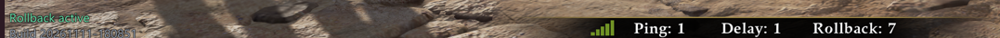
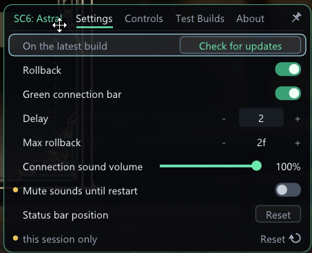
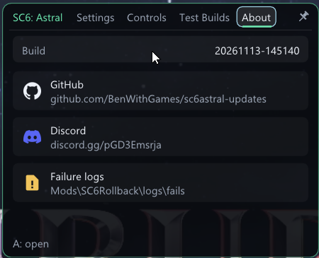

# Soul Calibur VI: Astral

## How to install
Welcome to Soul Calibur VI: Astral, as rollback mod for Steam copies of Soul Calibur VI. This mod is now in beta and you can download the latest release [here](https://github.com/BenWithGames/sc6astral-updates/releases). Extract anywhere and run `Install.exe`. Linux users will run `Install.run`. The prompt will ask you for the path to your SoulcaliburVI installation. Enter your path and press enter. Exit the command line when finished. Open Soul Calibur VI.
The mod automatically checks for new builds when you start the game and will check every 15 minutes to see if there is a new build. **You must be on the same build as your opponent to play rollback**.

## How does it work

To play rollback, simply play a match with someone else with the mod on the same version. If you connect to someone without the mod, you will be defaulted back to the native Soul Calibur VI netcode. You can take this mod into ranked or casual lobbies. If rollback is connected, you will see a new connection status bar on the bottom and a green text on the bottom left saying Rollback active.

You can set the delay and rollback frames manually. Delay frames will default to auto and rollback will default to 3 when you first install the mod. You can manually change the delay and rollback frames in the settings menu.

**Press F2 to open the settings menu**

## Customize your rollback experience

Pressing F2 opens the settings window. From here, you can configure the delay and rollback frames

The mod automatically is set to auto delay frames and 3 rollback frames, or you can manually select the delay and rollback frames to a max 7 frames. You can also manually set the delay to -1. Native Soul Calibur VI on PC has 1 frame of delay. -1 removes that delay. The auto setting does not use -1. If you want to use -1, **I recommend you have a very solid ping and computer for this**. -1 allows almost no time for inputs to be received by the mod. It's a very volatile setting. You can also turn off rollback in the mod if you so desire.

## What to do if you game crashes

Because the mod is still in beta, it is still prone to crashes, or shaky match experience. If the game crashes, you must closed the game and restart. Not required, but I would appreciate if you send the logs to the discord channel in the astral-logs-fail channel. Open the settings window with F2, click on the About tab and click on Failure Logs as shown on the screenshot

Send the fail logs from your latest match so that I may diagnose the issues and fix it.
